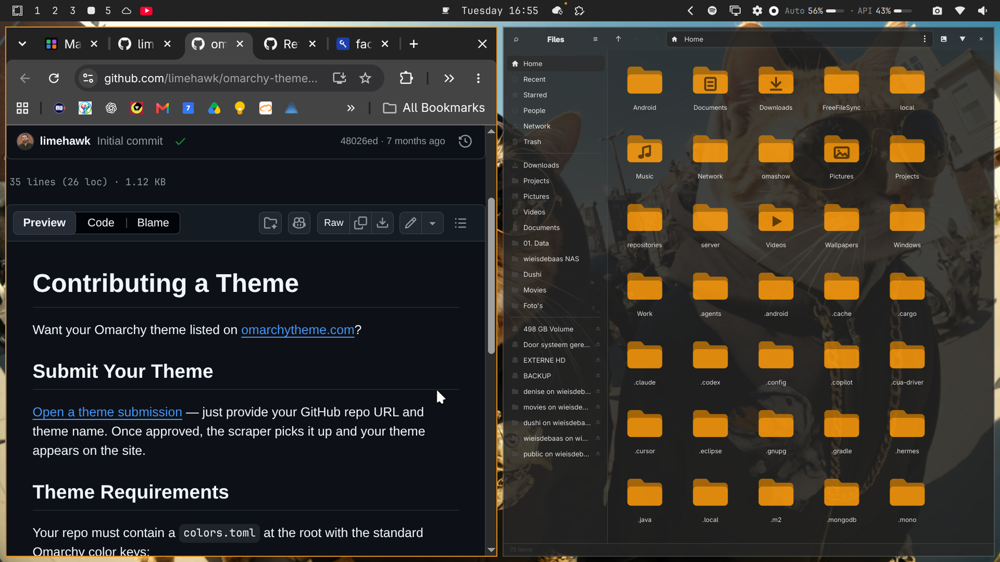

# Cats From The Hood

Omarchy theme by [wieisdebaas](https://github.com/wieisdebaas) — part of the **Cat themes** series.

Dark Ayaka-inspired palette with orange chrome (`#e68e0d`) for accents, borders, and folders.

Listed on [omarchytheme.com](https://omarchytheme.com/themes/cats-from-the-hood/).



## Install

```bash
omarchy theme install https://github.com/wieisdebaas/omarchy-cats-from-the-hood-theme.git
```

## Apply

```bash
omarchy theme set "Cats From The Hood"
```

Cycle wallpapers with `omarchy theme bg next`.

## Gallery files

This repo ships the files [omarchytheme.com](https://omarchytheme.com) scrapes:

- `colors.toml` — Omarchy v4 palette plus legacy `color0`–`color15` keys
- `preview.png` — desktop screenshot
- `README.md` — this file

## More cat themes

| Theme | Install |
| --- | --- |
| [Cosmic Cat](https://github.com/wieisdebaas/omarchy-cosmic-cat-theme) | `omarchy theme install https://github.com/wieisdebaas/omarchy-cosmic-cat-theme.git` |
| [Cosmic Cat Light](https://github.com/wieisdebaas/omarchy-cosmic-cat-light-theme) | `omarchy theme install https://github.com/wieisdebaas/omarchy-cosmic-cat-light-theme.git` |
| [Cats From The Hood](https://github.com/wieisdebaas/omarchy-cats-from-the-hood-theme) | `omarchy theme install https://github.com/wieisdebaas/omarchy-cats-from-the-hood-theme.git` |
